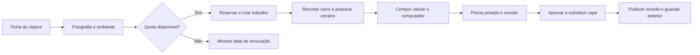

# Da viatura ao hero · arquitetura para o Claude

**Proposta de 15/10/2026, ainda não implementada.** Selecionar uma viatura registada, criar um cenário que combine com ela e publicar uma composição responsiva. O celular é a prioridade. Máximo de **duas trocas por semana por stand**, com controlo de geração e custos no servidor.

## Fluxo do proprietário

O ponto de entrada é `/painel/viaturas/[id]`, num cartão **Hero do site** depois de `StatusTrack` e antes dos separadores. Botão: **Preparar para o hero**. O separador Fotografias pode oferecer “Usar esta fotografia no hero”, abrindo o mesmo fluxo. Não publicar imediatamente ao tocar nesse botão.

Exemplo: o proprietário adiciona um **Peugeot e-208**, abre a ficha e prepara o hero. O sistema usa a fotografia desse e-208; não confundir com o Peugeot **2008** azul da demonstração atual.

1. **Fotografia:** selecionar uma fotografia da própria viatura, com carro inteiro e de preferência vista dianteira a três quartos. Recomendar a melhor e permitir confirmar outra. Se não houver resolução ou enquadramento suficientes, pedir outra fotografia antes de gastar geração.
2. **Ambiente:** sugerir um cenário compatível com cor, carroçaria e identidade do site. Oferecer três presets: arquitetura clara, urbano e costeiro. Para o e-208, a sugestão inicial é arquitetura urbana clara. Selecionar um preset não gera imagens.
3. **Gerar apresentação:** mostrar “Celular + computador” e a quota restante. Só este botão cria um trabalho. Atualizar a página ou repetir o toque acompanha o trabalho existente.
4. **Rever:** prévia de celular aberta por defeito, com 320 / 390 / 430 px e opção Computador. Mostrar imagem, título, botões e seletor reais. Ajustar texto, contraste e ponto focal não chama o gerador novamente.
5. **Publicar no lugar de…:** escolher a capa a substituir, por exemplo Mustang na primeira posição. Mostrar antes/depois e confirmar. A capa anterior continua publicada durante toda a geração e revisão.

Em `/painel/site`, manter organização das capas, rascunhos e histórico. A ficha inicia o processo e a página Site gere a montra completa. Ambos usam o mesmo serviço e a mesma quota.

## Encaixe no projeto existente

Inspeção dos ficheiros realizada nesta tarefa. Não é necessário criar outro dashboard.

Durante esta tarefa, a persistência passou em paralelo de SQLite/libSQL para PostgreSQL/Supabase. Implementar as novas transações e migrações no backend atual; não repor o esquema SQLite. Os exemplos preparados antes da mudança estão descritos em `EDITORIAL-MUSTANG.md`.

| Local existente | Evolução proposta para o Claude |
| --- | --- |
| `src/app/painel/(app)/viaturas/[id]/page.tsx` | Cartão Hero abaixo de `StatusTrack`, estado do trabalho, prévia aprovada e botão de preparação. |
| `src/components/painel/photo-manager.tsx` | Ação contextual de usar fotografia no hero. |
| `src/components/painel/site-forms.tsx` | Reutilizar `HeroManager`; acrescentar biblioteca, quota, histórico e ligação à ficha. Substituir a prévia simplificada por composição fiel à landing. |
| `src/app/painel/_actions/site.ts` | Centralizar regras de publicação e quota. **Hoje `saveHero` altera diretamente uma capa publicada**: mudar esse caminho para rascunho/revisão antes de publicar. Cobrir também `setHeroPublished` e `moveHero`. |
| `src/db/schema.ts`: `heroJobs` | Já existem estados, origem, brief, ficheiros desktop/mobile, tentativas e revisão. Acrescentar idempotência, fase, reserva de quota e metadados do fornecedor. |
| `heroSlides`, `files`, `vehiclePhotos`, `auditLogs` | Reutilizar para capas, assets aprovados, associação e auditoria. Não substituir automaticamente a fotografia original nem a capa comercial do veículo. |
| `src/server/public-catalog.ts` | Continuar a devolver apenas capas publicadas. Rascunhos, prompts, custos e quota são privados. |
| `src/lib/contracts.ts` | Preservar `HeroSlide` e os contratos atuais de geração. As duas imagens, pontos focais, tom de texto e `vehicleId` já são suportados. |

Módulos privados sugeridos: `src/server/hero/service.ts`, `quota.ts`, `provider.ts`, `composition.ts` e worker persistente. São nomes propostos, **não ficheiros criados** nesta entrega.

## Preservar o automóvel e gerar o ambiente

Obter máscara do carro e guardar um recorte com transparência. Gerar o cenário e recompor usando os pixels originais do veículo, com escala uniforme, posição e sombra coerentes. Não redesenhar jantes, carroçaria, cor, emblemas ou equipamento, nem espelhar automaticamente. Se a perspetiva não combinar, rever a fotografia ou o cenário. Uma edição integral por IA exige comparação com o original e rejeição caso altere o produto.

Produzir um conjunto coerente de celular e computador a partir do mesmo recorte, preset e direção visual. Se um cenário amplo permitir recompor os dois formatos com qualidade, reutilizá-lo. Caso contrário, preparar as duas áreas de fundo dentro do orçamento do conjunto. Não gerar várias alternativas em paralelo por defeito.

Os cenários são ilustrativos; não representam instalações reais nem comprovam o estado comercial da viatura. Não gerar preço, título ou botões dentro da fotografia: o texto permanece HTML e os dados comerciais vêm do registo revisto.

### Composição responsiva

- Celular aprovado primeiro. Texto e ação na zona superior; carro inteiro na região central; controlos sobre chão livre. **Uma única composição com fotografia ao fundo**, nunca texto e imagem em blocos empilhados.
- Guardar vertical e horizontal próprias. Atualmente a vertical é usada até 800 px, com composição móvel até 600 px. A prévia deve usar os mesmos breakpoints, alturas, fontes e botões da landing.
- Validar em 320, 390 e 430 px, tablet e computador: rodas, retrovisores, carro inteiro, contraste e alvos de toque. Dimensões corretas do ficheiro não bastam para aprovar.
- Guardar caixa delimitadora do carro e zonas livres para texto por formato, além dos pontos focais. Detetar recortes fora do limite antes da revisão humana.
- Extrair, de forma coordenada, um componente de apresentação partilhado por landing e prévia autenticada. Sem autenticação, credenciais ou geração dentro desse componente.
- Publicar sempre o par `imageDesktop` / `imageMobile` e os respetivos pontos focais juntos; não deixar uma imagem de outro veículo num dos formatos.

## Limite semanal e controlo de consumo

Proposta operacional para evitar tanto trocas excessivas como gerações descartadas sem limite:

| Regra | Comportamento |
| --- | --- |
| Âmbito | Por stand, partilhado por todos os utilizadores e posições do hero. Nunca apenas por navegador/utilizador. |
| Semana | Segunda-feira 00:00 até à segunda seguinte, em `Europe/Lisbon`, incluindo mudança de hora. Guardar os limites UTC calculados pelo calendário local. |
| Publicação | Máximo de **2 trocas** por semana. Trocar a viatura/composição de uma posição publicada conta. Reordenar para mudar o primeiro destaque também conta. |
| Geração | Máximo de **2 conjuntos novos** por semana, cada um com celular e computador. Descartar uma geração não devolve automaticamente a quota. |
| Biblioteca pronta | Reutilizar imagens aprovadas não gasta geração, mas a troca publicada continua a contar no limite de duas. |
| Ajustes | Texto, preço vindo do stock, cor do texto e ponto focal não geram imagens nem contam como troca de composição. |
| Viatura indisponível | Retirar do ar uma capa vendida/indisponível continua possível sem quota. A substituição ou republicação posterior segue as regras normais. |
| Visitante do site | Tocar nos destaques já publicados nunca consome quota. Não é geração nem publicação. |

Mostrar “Trocas: 1/2”, “Gerações: 1/2” e a data concreta de renovação. A regra de geração é um controlo adicional proposto para cumprir o objetivo de custo; o limite solicitado de duas trocas publicadas é mantido.

Reservar quota **antes** da chamada paga, em transação: validar permissão, associação fotografia/viatura, quota, pedido duplicado e trabalho em curso; inserir reserva, trabalho e mensagem de despacho juntos. Duas pessoas concorrentes não podem criar uma terceira geração.

Uma reserva em processamento não pode expirar enquanto o fornecedor ainda pode devolver imagem. Guardar o identificador do pedido e reconciliar timeouts. Falha anterior a qualquer chamada paga pode libertar a reserva. Falha com cobrança desconhecida fica pendente de reconciliação, sem nova chamada cega. Cancelar depois de começar não devolve automaticamente a unidade.

Além de dois conjuntos, configurar um teto monetário semanal e tentativas limitadas por fase. O valor depende do fornecedor e deve ser confirmado antes da ativação. Se só a gravação falhar, guardar o resultado já obtido sem nova geração; se um formato falhar, retomar apenas esse formato dentro do orçamento. Não regenerar automaticamente o que já está pronto.

Todas as vias de publicação — ações atuais, endpoints futuros, ordenação e importações futuras — passam pelo mesmo serviço. Desativar o botão não é suficiente. Não criar um bypass administrativo ilimitado.

## Persistência e execução

Manter os estados atuais: `queued → processing → review → approved`, com `failed` e `rejected`. Aprovação e publicação são etapas diferentes: `approved` por si só não significa ativo no site.

Extensões sugeridas:

- `heroJobs`: chave de idempotência única, hash da foto de origem, preset/versão, fase, identificador do fornecedor, reserva, lease, orçamento/custo e erros estruturados. `requestedBy` vem da sessão, nunca do browser.
- `heroUsagePeriods`: stand, início/fim de semana, gerações reservadas/concluídas, trocas e custo reservado/confirmado. Atualização condicional em transação, sem contar e inserir em operações separadas.
- `heroRevisions`: configuração imutável, par de ficheiros, fotografia de origem/job, posição, autor e revisão anterior.
- `heroPublicationEvents`: evento idempotente ligando revisão anterior/nova e período de quota. Repetir a mesma publicação não consome duas trocas.

Usar fila durável com mensagem de saída gravada na transação do trabalho e worker com lease. O processamento não pode depender de manter o browser aberto nem de uma promessa solta depois do pedido HTTP.

Ao publicar, verificar `expectedRevision`: se outra pessoa mudou a capa desde a prévia, mostrar conflito e pedir nova revisão. Na transação, verificar viatura atual e quota, gravar evento/revisão, trocar ambos os assets e atualizar contadores. Só depois invalidar cache. Falhas preservam a capa anterior. Reversões para outra composição também são publicações sujeitas à quota; uma retirada urgente continua livre.

Resultados em revisão ficam privados, acessíveis com sessão. Só expor `/media/...` depois de aprovados. Reutilizar armazenamento e permissões existentes (`vehicles.view`, `site.edit`), acrescentando permissão própria de geração se necessário. Validar associação entre ficheiro e viatura; receber IDs internos, não URLs arbitrárias para download. Não enviar documentos, dados de clientes ou credenciais ao gerador. Excluir da limpeza qualquer ficheiro referenciado por capa, revisão ou job.

## Interface privada sugerida

Implementar como Server Actions ou endpoints privados equivalentes, sem duplicar regras:

- `getHeroPreparation(vehicleId)`: fotos elegíveis, estado, conjunto reutilizável e quotas.
- `requestHeroPreparation({vehicleId, sourceFileId, presetId, idempotencyKey})`: reserva e cria `jobId`; não publica.
- `getHeroJob(jobId)`: fase e resultados autorizados. Poll com backoff, sem gerar no polling.
- `reviewHeroJob({jobId, decision, focalPoints, copy})`: aprovação/rejeição e ajustes locais.
- `publishHeroRevision({jobId, targetSlideId, expectedRevision, idempotencyKey})`: troca atómica.

Erros orientam a pessoa: foto inadequada, quota esgotada com data de renovação, fornecedor indisponível, veículo vendido ou capa alterada por outra pessoa. Sem chaves nem respostas internas do fornecedor na UI.

## Critérios de aceitação

1. Preparar o e-208 usa a fotografia desse registo e mantém o Mustang publicado até aprovação e publicação explícitas.
2. Duplo toque, reload e regresso à ficha acompanham o mesmo trabalho, sem cobrança duplicada.
3. Concorrência entre utilizadores não ultrapassa duas gerações nem duas trocas na mesma semana.
4. O par preserva o carro e passa revisão com texto e botões reais nos três tamanhos de celular.
5. Rejeitar duas gerações impede uma terceira. Biblioteca aprovada evita geração, mas não contorna quota de publicação.
6. Falha, timeout ou reinício recupera o job sem substituir a capa ativa nem repetir custo sem reconciliação.
7. `saveHero`, `setHeroPublished` e `moveHero` não contornam as regras; retirar uma viatura vendida continua permitido.
8. Renovação semanal correta em Lisboa, incluindo mudança de hora e passagem de ano.
9. Desktop/mobile publicados juntos, com revisão anterior, autor e consumo no histórico.
10. Contrato público preservado; nenhum prompt privado, custo, job ou segredo no bundle da landing.

## Ordem de implementação

Primeiro: cartão na ficha, biblioteca e prévia fiel. Depois: rascunhos, quotas e serviço único de publicação cobrindo as ações existentes. Em seguida: fila, worker, fornecedor, máscara e composição. Por fim: teste de ponta a ponta com carro real, revisão mobile e custo confirmado antes de ativar. Confirmar o fornecedor/modelo na implementação; nenhuma credencial nem API operacional é presumida por este documento.
